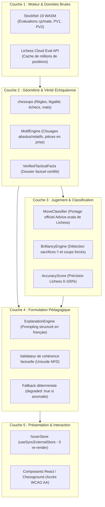

# Architecture Technique — Chess Analyzer

Ce document décrit l'architecture logicielle, le découpage en couches d'autorité, les flux de données et les mécanismes de résilience de **Chess Analyzer**.

---

## 1. Vue d'ensemble du Monorepo

```
chess_analyzer/
├── apps/
│   └── web/                     # Application Next.js 16 (App Router, Turbopack)
│       ├── app/api/coach/       # Passerelle sécurisée LLM (filtrage Origin/Host, rate limit)
│       ├── app/components/      # Composants d'orchestration (NavigationBar, HelpModal)
│       ├── app/stores/          # Stores d'état découplés (hoverStore via useSyncExternalStore)
│       └── app/page.tsx         # Orchestrateur réactif principal
├── packages/
│   ├── chess-core/              # Cœur échiquéen agnostique de framework (TypeScript strict)
│   │   ├── src/engine/          # Gestionnaire Stockfish UCI WASM & capacités
│   │   ├── src/analysis/        # Normalisation cp/winProb, scores de précision Lichess
│   │   ├── src/pedagogy/        # Moteur d'explication factuel, classification, motifs
│   │   ├── src/services/        # Pipeline d'analyse séquentielle, MoveManager, GameManager
│   │   └── src/parser/          # Parser PGN bilingue (FR/EN) avec support RAV arborescent
│   └── ui/                      # Bibliothèque de composants visuels (Chessground, Tailwind 4)
│       ├── src/Board/           # Échiquier ChessBoard & Canvas de flèches
│       ├── src/Coach/           # CoachBubble, affichage des fiches pédagogiques
│       ├── src/GameReview/      # Mode défi, réessai de gaffe, indices progressifs
│       └── src/EvalBar/         # Barre d'évaluation et thermomètre de chances de gain
└── scripts/                     # Outils de vérification et suites de tests adversariaux
```

---

## 2. Doctrine des 5 Couches d'Autorité (L1 à L5)

Pour éliminer définitivement les hallucinations d'IA sans brider la richesse pédagogique, l'autorité suit un flux strictement unidirectionnel :



### Règles d'or d'autorité
1. **L1 prime sur les intuitions** : Les centipions et les variantes de calcul proviennent exclusivement du moteur ou de la base cloud.
2. **L2 détient la vérité matérielle** : Un échec, un mat, un clouage ou une capture n'existent que si `chessops` ou `MotifEngine` en attestent la réalité géométrique sur la position résultante.
3. **L3 tranche la qualité** : L'IA ne décide jamais de la classification d'un coup (`best`, `mistake`, `blunder`). Elle ne fait que commenter le verdict déjà scellé par les formules Lichess.
4. **L4 valide chaque mot** : Toute affirmation générée par le modèle de langage qui prétend qu'une pièce est en prise, clouée ou matée alors que `VerifiedTacticalFacts` dit le contraire est immédiatement rejetée. Le système bascule sans délai sur la fiche locale déterministe.
5. **L5 ne re-rend que le nécessaire** : Le survol des coups et des formes n'altère pas l'état du composant racine `Home`. Seul le composant échiquier `ActiveChessBoard` se rafraîchit.

---

## 3. Sécurité de la Passerelle Coach (`/api/coach`)

La route d'API `apps/web/app/api/coach/route.ts` protège l'application et les budgets d'inférence contre les abus :
- **Filtrage de domaine** : Rejet systématique avec code HTTP 403 si l'en-tête `Origin` ou `Host` ne correspond pas aux domaines autorisés.
- **Interdiction d'injection système** : Le prompt système est strictement injecté par le serveur. Tout message client avec `role: 'system'` est rejeté.
- **Plafonnement des échanges** : Historique borné à 12 messages maximum pour prévenir les requêtes coûteuses.
- **Budget de session** : Décompte client (`tryConsumeBudget()`) plafonnant à 40 appels LLM par session avant bascule transparente sur les fiches locales.

---

## 4. Protocole de Non-Régression

Toute contribution doit valider :
1. **243 tests unitaires et d'intégration** (`vitest run` sur les 3 paquets).
2. **12 tests adversariaux d'école échiquéenne** (`scripts/verify-v533-p0-adversarial.ts`).
3. **0 erreur TypeScript** (`tsc --noEmit`).
4. **Build de production Next.js** (`npm run build`).
